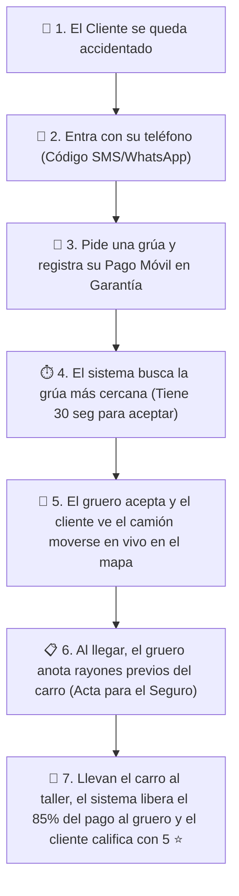

# 📖 Guía Explicativa para el Equipo: ¿Cómo Funciona Josepo Mejorado?
*(Explicación clara, paso a paso y sin tecnicismos complicados)*

¡Bienvenidos al repositorio del equipo! Este documento fue creado para que cualquier integrante del proyecto comprenda **qué hace exactamente nuestra aplicación**, **cómo se conectan sus partes** y **de qué se encarga cada archivo de código** usando ejemplos de la vida real.

---

## 💡 1. ¿Qué es Josepo Mejorado en palabras sencillas?

Imagina que combinas tres herramientas en una sola aplicación para Venezuela:
1. **Un "Uber de Grúas":** Cuando un carro se queda accidentado en la vía, busca automáticamente la grúa disponible más cercana y la envía al rescate.
2. **Una "Caja Fuerte de Pago Móvil" (Escrow):** El cliente paga por Pago Móvil al pedir la grúa, pero el dinero queda **retenido en garantía** dentro de la plataforma. Recién cuando el chofer entrega el vehículo sano y salvo, el sistema libera el dinero (**85% para el gruero** y **15% para la plataforma**). Así nadie estafa a nadie.
3. **Un "Waze Comunitario con Premios y Botón SOS":** Los conductores reportan accidentes o alcabalas en el mapa, ganan puntos cuando otros confirman que el reporte es real, canjean esos puntos por descuentos en talleres mecánicos aliados y cuentan con un **Botón SOS por Voz** que avisa por WhatsApp/SMS a su familia con su ubicación en vivo.

---

## 🔄 2. El Viaje Completo de un Rescate (Paso a Paso)

---

## 🖥️ 3. Las 3 Pantallas Web (`app/templates/`)

Cuando abrimos la aplicación en el navegador, existen **3 vistas principales**, cada una pensada para una persona distinta:

| Archivo | ¿Quién la usa? | ¿Qué se hace en esta pantalla? |
| :--- | :--- | :--- |
| **`app/templates/client.html`** | **El Conductor Accidentado (Cliente)** | • Entrar rápido con contraseña o con un código de 6 dígitos enviado por SMS/WhatsApp. • Pedir auxilio vial en el mapa y ver cuánto cuesta en Dólares (`$`) y en Bolívares (`Bs.`) a tasa BCV. • Registrar su **Pago Móvil en Garantía**. • Activar el **Botón SOS Familiar** (tocando el botón o diciendo *"¡Auxilio Josepo!"* al micrófono). • Reportar accidentes en la vía, ganar puntos y canjear cupones en talleres. |
| **`app/templates/driver.html`** | **El Chofer de la Grúa (Versión Web)** | • Ponerse "En Turno (Disponible)" o "Fuera de Servicio". • Escuchar la alarma cuando entra un pedido cercano y aceptarlo antes de que pasen **30 segundos**. • Avanzar por los 4 pasos del viaje (*En camino $\rightarrow$ Llegué al sitio $\rightarrow$ Carro cargado $\rightarrow$ Finalizar*). • Llenar la planilla de **Inspección del Vehículo** (placa, color y rayones previos). |
| **`app/templates/admin.html`** | **Los Dueños / Torre de Control** | • Ver en un mapa gigante dónde están todas las grúas del país en vivo (verdes = libres, rojas = ocupadas, grises = apagadas). • Ver cuántos rescates llegaron en menos de 30 minutos. • Ver cuánto dinero ha entrado en el día y las actas firmadas. |

---

## 🗂️ 4. ¿De qué se encarga cada archivo del Servidor (`app/`)?

Para no mezclar todo en un solo archivo gigante, organizamos el servidor como si fuera una **empresa bien ordenada** dividida en 4 departamentos:

### A. La Puerta Principal y Configuración (`Raíz` y `app/`)
* **`run.py`**: Es el **botón de encendido**. Cuando lo ejecutamos, arranca el servidor web y las comunicaciones en tiempo real.
* **`seed_data.py`**: Es el **cargador de datos de prueba**. Crea automáticamente las tablas, el usuario administrador, 5 grúas de ejemplo en Caracas, Maracay, Valencia y Puerto Ordaz, y los talleres aliados para que todo el equipo pueda probar sin empezar en blanco.
* **`app/__init__.py`**: Es el **director de orquesta**. Une todas las piezas de la aplicación, activa los mapas, las rutas y devuelve las páginas `/client`, `/driver` y `/admin`.
* **`app/config.py`**: Es el **manual de reglas**. Guarda cuánto cuesta el kilómetro de remolque, cuál es la dirección de la base de datos (**PostgreSQL + PostGIS**) y verifica que en producción nadie use contraseñas débiles.
* **`app/extensions.py`**: Es el **guardia de seguridad de la entrada**. Configura el candado que frena ataques de hackers (`Flask-Limiter`), bloquea páginas web extrañas que intenten conectarse a nuestro servidor (`CORS`) y activa el canal en vivo (`SocketIO`).

---

### B. Los Archivadores de Datos (`app/models/`)
Cada archivo dentro de `app/models/` es como una **hoja de Excel o ficha de archivo** donde guardamos un tipo de información en la base de datos:

* **`user.py`**: Guarda la ficha de cada persona (nombre, correo, teléfono, si es Cliente, Chofer o Administrador, cuántos puntos tiene acumulados, su medalla de rango vial y el teléfono de su familiar de emergencia).
* **`tow_truck.py`**: Guarda la ficha de cada grúa (placa, modelo del camión, a qué chofer pertenece, si está libre u ocupada y sus coordenadas GPS actuales).
* **`tow_request.py`**: Guarda cada pedido de auxilio vial (quién lo pidió, qué grúa lo atiende, desde dónde hasta dónde va, cuánto cuesta en centavos de dólar y bolívar, y en qué etapa va el viaje).
* **`payment.py`**: Guarda los recibos de **Pago Móvil** (banco emisor, cédula, teléfono, número de referencia bancaria, el 85% que le toca al chofer, el 15% de la plataforma y si el dinero sigue retenido en garantía o ya fue liberado).
* **`service_contract.py`**: Guarda el **Acta Legal de Inspección** del vehículo remolcado (placa, modelo, rayones previos antes de subirlo a la grúa, un sello digital único para las empresas de seguros y la calificación de 1 a 5 estrellas del cliente).
* **`otp_verification.py`**: Guarda los códigos temporales de 6 dígitos que se envían por SMS/WhatsApp. Si alguien se equivoca 3 veces tratando de adivinar el código, este archivo lo bloquea de inmediato.
* **`traffic_report.py`**: Guarda los reportes de tráfico en la vía (choques, vías cerradas, alcabalas, carros varados) y cuántas personas han confirmado que el reporte es verdadero.
* **`reward.py`**: Guarda tres cosas del programa de fidelidad: la lista de **Talleres Aliados** con sus descuentos, el historial de puntos ganados y los cupones canjeados por los usuarios.
* **`exchange_rate.py`**: Guarda el historial de la tasa oficial del dólar **BCV** con fecha y hora exacta.

---

### C. Los "Cerebros" del Negocio (`app/services/`)
Aquí vive la inteligencia de la aplicación. Ningún archivo de aquí dibuja pantallas; su único trabajo es **tomar decisiones y hacer cálculos exactos**:

* **`dispatch_service.py` (El Despachador Inteligente):**
  * Cuando alguien pide una grúa, busca todas las grúas libres, calcula cuál está más cerca y le envía la oferta.
  * Activa un **reloj de 30 segundos**. Si ese chofer no responde en 30 segundos, pone a esa grúa en una lista de "ya intentados" y le pasa el pedido automáticamente a la segunda grúa más cercana.
* **`payment_service.py` (El Cajero y Custodio de Garantías):**
  * Conoce los **22 bancos de Venezuela** para Pago Móvil.
  * Recalculando el monto directamente en el servidor (para que nadie pueda alterar el precio desde el navegador), guarda el pago en estado `HELD_IN_ESCROW` (retenido) y, cuando el rescate termina, libera el **85% al chofer** y el **15% a Josepo**.
* **`contract_service.py` (El Inspector de Seguros y Auditor de Tiempo):**
  * Crea el acta digital cuando la grúa llega al sitio, calcula cuántos minutos tardó en llegar (verificando si cumplió la meta de **menos de 30 minutos**) y genera un sello digital (`SHA-256`) que ningún taller ni chofer puede falsificar después.
* **`geo_service.py` (El Navegador y Detector Anti-Trampas GPS):**
  * Calcula la distancia por carretera entre la grúa, el cliente y el taller.
  * **Detector Anti-Spoofing:** Si una grúa aparece en Caracas y 2 segundos después su celular dice que está en Valencia (como si viajara a más de 180 km/h usando una aplicación de *Fake GPS*), este archivo detecta la trampa y rechaza la ubicación falsa.
* **`currency_service.py` (El Contador Cambiario con Reloj Automático):**
  * Consulta automáticamente la tasa oficial del **BCV** cada 30 minutos (mediante un *Cronjob* en segundo plano) y hace todas las cuentas en **centavos enteros** para que jamás se pierda ni un céntimo por redondeos.
* **`gamification_service.py` (El Encargado del Club de Puntos):**
  * Suma puntos automáticamente cuando un usuario reporta un incidente (+25 pts) o confirma el de otro compañero (+10 pts), sube de rango al conductor (`BRONCE` $\rightarrow$ `PLATA` $\rightarrow$ `ORO` $\rightarrow$ `GUARDIÁN VIAL`) y genera los códigos de cupón (`JOSEPO-XXXXXX`) para los talleres mecánicos.
* **`notification_service.py` y `otp_service.py` (Los Mensajeros de Emergencia):**
  * Envían los códigos de acceso de 6 dígitos y disparan la **Alerta SOS Familiar**, creando un enlace especial para que el familiar vea en su celular por dónde va la grúa que lleva a su ser querido.
* **`admin_service.py` (El Analista de la Torre de Control):**
  * Reúne las estadísticas en vivo para la pantalla de administración: cuántas grúas están activas, qué porcentaje de servicios cumplió la meta de 30 minutos y cuánto dinero hay en caja.

---

### D. Las Ventanillas de Atención (`app/api/` y `app/sockets/`)
Son los puentes que conectan los botones de las pantallas con los "Cerebros" (`services/`):
* **`app/api/auth_routes.py` y `otp_routes.py`**: Reciben el inicio de sesión y verifican el código SMS/WhatsApp.
* **`app/api/tow_routes.py` y `driver_routes.py`**: Reciben el pedido de grúa del cliente y las respuestas del chofer.
* **`app/api/payment_routes.py`**: Recibe los datos del Pago Móvil y confirma las transferencias.
* **`app/api/contract_routes.py`**: Recibe el formulario de rayones previos y las estrellas de calificación.
* **`app/api/traffic_routes.py` y `gamification_routes.py`**: Reciben los reportes viales, las confirmaciones, los canjes de cupones y el disparo del botón SOS Familiar.
* **`app/sockets/events.py`**: Es el **walkie-talkie en tiempo real**. Cada 3 segundos recibe la coordenada GPS del camión y la mueve suavemente en la pantalla del cliente sin que tenga que recargar la página.

---

## 📱 5. La Aplicación Móvil en Flutter (`driver_mobile_flutter/`)

Además de la versión web, creamos el proyecto de la aplicación móvil nativa para el celular Android/iOS del chofer de la grúa:

* **`lib/main.dart`**: Arranca la app en el celular, activa el servicio de ubicación y recuerda la sesión del chofer para que no tenga que escribir su clave cada vez que abre la app.
* **`lib/screens/login_screen.dart`**: Pantalla de ingreso donde el chofer elige su unidad (`GRU-001` a `GRU-005`) o entra con código SMS/WhatsApp.
* **`lib/screens/home_map_screen.dart`**: Pantalla principal con el mapa, el botón para abrir la ruta directamente en **Waze o Google Maps**, la alerta de 30 segundos cuando cae un servicio y los botones para reportar cada etapa del remolque.
* **`lib/screens/wallet_screen.dart`**: La **Billetera del Chofer**, donde ve cuánto ha ganado en el día (su 85% neto en dólares y bolívares BCV) y qué pagos están por liberarse.
* **`lib/screens/profile_screen.dart`**: Muestra los datos de su camión, revisa si el permiso de GPS está en *"Permitir siempre"* y le permite canjear sus puntos en talleres aliados.
* **`lib/core/background_location_service.dart` y `socket_service.dart`**: Se encargan de que **aunque el gruero bloquee la pantalla del teléfono o se pase a la app de Waze**, el celular siga enviando su ubicación GPS a la central sin interrupciones.

---

## 🛡️ 6. Herramientas de Seguridad y Automatización (`app/utils/`, `scripts/` y `tests/`)

* **`app/utils/rate_limiter.py` y `schema_validator.py`**: Son los filtros de seguridad que impiden que alguien intente adivinar contraseñas por fuerza bruta o enviar código malicioso en los formularios.
* **`scripts/cron_update_bcv.py`**: Es el reloj automático que actualiza el precio del dólar BCV en segundo plano.
* **`scripts/init_postgis.sql` y `docker-compose.yml`**: Configuran el servidor profesional con **PostgreSQL y PostGIS** para soportar cientos de grúas conectadas al mismo tiempo sin colapsar.
* **`tests/` (`test_phase3.py` a `test_phase7.py` y `test_security_audit.py`)**: Son **25 pruebas robotizadas** que simulan clientes, choferes, pagos, alertas SOS y hasta intentos de hackeo para comprobar en pocos segundos que todo el código funciona a la perfección.
